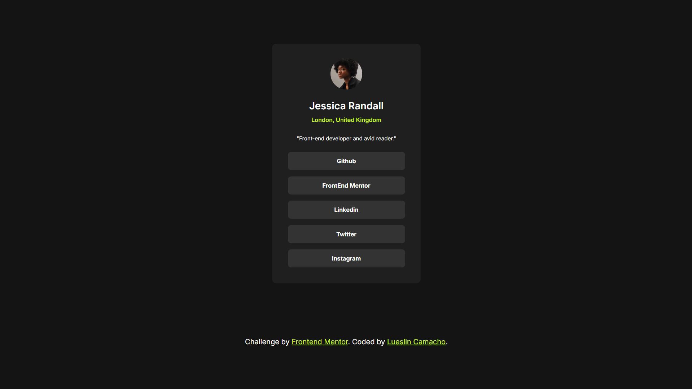

# Frontend Mentor - Social links profile solution

This is a solution to the [Social links profile challenge on Frontend Mentor](https://www.frontendmentor.io/challenges/social-links-profile-UG32l9m6dQ). Frontend Mentor challenges help you improve your coding skills by building realistic projects. 

## Table of contents

- [Overview](#overview)
  - [The challenge](#the-challenge)
  - [Screenshot](#screenshot)
  - [Links](#links)
- [My process](#my-process)
  - [Built with](#built-with)
  - [What I learned](#what-i-learned)
  - [Continued development](#continued-development)
  - [Useful resources](#useful-resources)
  - [AI Collaboration](#ai-collaboration)
- [Author](#author)

## Overview

### The challenge

Users should be able to:

- See hover and focus states for all interactive elements on the page

### Screenshot



### Links

- Solution URL: [GitHub Repository](https://github.com/Lueslin/social-links-profile)
- Live Site URL: [Live Site](https://lueslin.github.io/social-links-profile/)

## My process

### Built with

- Semantic HTML5 markup (`<main>`, `<article>`, `<ul>`, `<footer>`)
- CSS custom properties (`:root` variables)
- CSS Flexbox
- Keyboard accessibility (`:focus-visible`)
- Mobile-first workflow
- [Google Fonts](https://fonts.google.com/) - Inter font family (400, 600 & 700)

### What I learned
# Frontend Mentor - Social links profile solution

This is a solution to the [Social links profile challenge on Frontend Mentor](https://www.frontendmentor.io/challenges/social-links-profile-UG32l9m6dQ). Frontend Mentor challenges help you improve your coding skills by building realistic projects.

## Table of contents

- [Overview](#overview)
  - [The challenge](#the-challenge)
  - [Screenshot](#screenshot)
  - [Links](#links)
- [My process](#my-process)
  - [Built with](#built-with)
  - [What I learned](#what-i-learned)
  - [Continued development](#continued-development)
  - [Useful resources](#useful-resources)
  - [AI Collaboration](#ai-collaboration)
- [Author](#author)

## Overview

### The challenge

Users should be able to:

- See hover and focus states for all interactive elements on the page

### Screenshot


### Links

- Solution URL: [GitHub Repository](https://github.com/Lueslin/social-links-profile)
- Live Site URL: [Live Site](https://lueslin.github.io/social-links-profile/)

## My process

### Built with

- Semantic HTML5 markup (`<main>`, `<article>`, `<ul>`, `<footer>`)
- CSS custom properties (`:root` variables)
- CSS Flexbox
- Mobile-first workflow
- [Google Fonts](https://fonts.google.com/) - Inter font family (400, 600 & 700)

### What I learned

In this third Frontend Mentor challenge, I focused on organizing design tokens in `:root`, building a vertical stack of interactive social buttons with Flexbox, and applying smooth hover color transitions. Key takeaways include:

- **Comprehensive `:root` Design Tokens:** Storing not only the dark-mode color palette (`--green`, `--gray`, `--graymedium`, `--graystrong`) but also font family and font-weight variables (`--regular`, `--semibold`, `--bold`) made the stylesheet cleaner and easier to adjust.
- **Flexbox Centering & Vertical Link Stack:** Using `display: flex` with `flex-direction: column` to center the profile card inside the viewport (`min-height: 100vh`) and align the avatar, text elements, and `.profile_links` list items evenly.
- **Smooth Hover Transitions:** Combining `transition: background-color 0.3s ease` on `.profile_links li` with `transition: color 0.3s ease` on the anchor tags so both the button background (`#C5F82A`) and text color (`#141414`) shift smoothly on hover.
- **Responsive Card Protection:** Pairing `width: 330px` with `max-width: 100%` on `.card` to prevent horizontal overflow on smaller mobile viewports.

```css
.profile_links li {
  display: flex;
  justify-content: center;
  background-color: var(--gray);
  width: 260px;
  padding: 12px;
  border-radius: 7px;
  font-size: 13px;
  font-weight: var(--semibold);
  transition: background-color 0.3s ease;
  cursor: pointer;
  margin-bottom: 10px;
}

.profile_links li:hover {
  background-color: var(--green);
}

.profile_links li:hover a {
  color: var(--graystrong);
}

### Continued development

Moving forward, I plan to expand keyboard navigation support with :focus-visible states on anchor elements, explore CSS Grid for multi-column layouts, and start introducing JavaScript for interactive UI components.

### Useful resources

- MDN Web Docs - Using CSS custom properties (variables) - Helped me organize color and font-weight tokens cleanly inside :root.

- MDN Web Docs - CSS Transitions - Useful reference for smoothing out the background and text color changes on :hover.

- A Complete Guide to Flexbox (CSS-Tricks) - Essential guide for centering the card container and stacking the profile links vertically.

### AI Collaboration

I worked with Gemini as a code reviewer and mentor during this challenge. I wrote the HTML structure and CSS layout independently, using AI feedback to check HTML tag nesting, validate relative image paths for GitHub Pages deployment, and document the project in this README.

## Author

- Website - [Lueslin Camacho](www.behance.net/logicbylueslin)
- Frontend Mentor - [@lueslin](https://www.frontendmentor.io/profile/lueslin)
